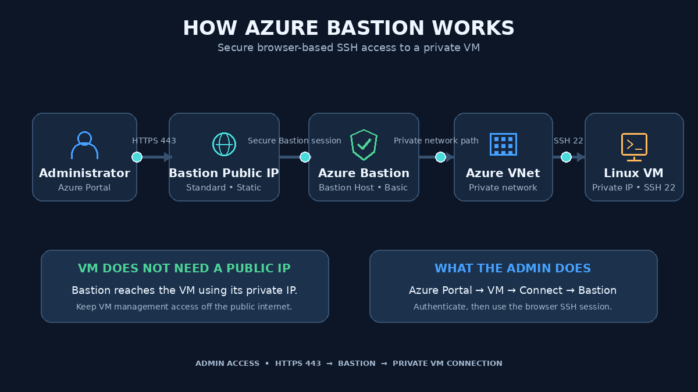

# 🚀 Azure Bastion using Terraform

A hands-on project demonstrating how to deploy **Azure Bastion using Terraform** and establish secure SSH connectivity to Azure Virtual Machines without exposing them directly to the public internet.

## 🏗️ Azure Bastion Architecture



## 1. 🎯 Project Overview

This project provisions Azure Bastion and its required networking infrastructure using reusable Terraform modules.

**Resources created:**
- Azure Resource Group
- Virtual Network (VNet)
- Azure Bastion Subnet
- Standard Static Public IP
- Azure Bastion Host

## 2. 🤔 Why Azure Bastion?

Azure Bastion provides secure SSH and RDP connectivity to Azure Virtual Machines through the Azure Portal.

**Without Bastion:**
- VMs may require public IP addresses for direct SSH/RDP access.
- Management ports like SSH (22) may be exposed to the internet.

**With Bastion:**
- VMs do not need public IPs for Bastion-based management access.
- Connections are established using the VM's private IP.
- Administrators can connect directly through the Azure Portal.

## 3. 🏗️ Architecture & Connection Flow

```text
       Administrator
             |
             | HTTPS (443)
             v
     Azure Bastion Public IP
             |
             v
       Azure Bastion
             |
             v
        Azure VNet
             |
             | Private IP
             v
        Linux VM
         SSH (22)
```

**Connection process:**

1. Open Azure Portal.
2. Navigate to the target Virtual Machine.
3. Select Connect → Bastion.
4. Enter VM credentials.
5. Establish a browser-based SSH session.

## 4. 📁 Terraform Project Structure

```text
lets-learn-azure-bastion-terraform/
│
├── Modules/
│   ├── BASTION/
│   ├── PUBLIC_IP/
│   ├── RG/
│   ├── SUBNET/
│   └── VNET/
│
├── Environments/
│   └── Prod/
│       ├── main.tf
│       ├── variables.tf
│       └── terraform.tfvars.example
│
├── .gitignore
└── README.md
```

The project follows a modular architecture:
- **Parent module:** Connects and manages the child modules.
- **Child modules:** Handle individual Azure resources.
- **Data Sources:** Reference the existing Bastion subnet and Public IP.

## 5. ⚙️ Azure Bastion Configuration

| Configuration | Value |
|---|---|
| Resource Group | `rg-prod` |
| Location | Central India |
| Virtual Network | `vnet-prod` |
| VNet Address Space | `15.0.0.0/16` |
| Bastion Subnet | `AzureBastionSubnet` |
| Subnet Address Range | `15.0.3.0/24` |
| Public IP SKU | Standard |
| Public IP Allocation | Static |
| Bastion Host SKU | Basic |

**Note:** Bastion Host SKU and Public IP SKU are different configurations. This project uses Basic for the Bastion Host and Standard Static for its Public IP.

The address range is retained from the learning environment. For new deployments, choose a suitable private RFC1918 address range and check for network overlaps.

## 6. 🚀 Deployment Steps

**Prerequisites:**
- Azure subscription
- Azure CLI
- Terraform CLI
- Required Azure permissions

**Deployment commands:**

```bash
# Clone repository
git clone https://github.com/YOUR-USERNAME/lets-learn-azure-bastion-terraform.git

# Navigate to project
cd lets-learn-azure-bastion-terraform/Environments/Prod

# Authenticate with Azure
az login

# Create local variables file
cp terraform.tfvars.example terraform.tfvars

# Initialize Terraform
terraform init

# Validate configuration
terraform validate

# Review deployment plan
terraform plan

# Deploy infrastructure
terraform apply
```

Review the Terraform plan carefully before confirming deployment.

## 7. 🖥️ Connect to VM Through Bastion

After successful deployment:

1. Open Azure Portal.
2. Navigate to Virtual Machines.
3. Select the target Linux VM.
4. Click **Connect → Bastion**.
5. Enter the VM username and authentication credentials.
6. Click Connect.

<text>**Expected result:**</text>

```bash
Naruto@frontmachine:~$ pwd
/home/Naruto
```

A successful SSH session confirms connectivity through Azure Bastion.

## 8. 🔐 Security Best Practices

- Avoid exposing VM public IPs unnecessarily.
- Restrict SSH/RDP access through appropriate NSG rules.
- Prefer SSH keys or supported secure authentication methods.
- Never hardcode passwords or secrets in Terraform files.
- Use Azure Key Vault for sensitive information.
- Follow least-privilege access using Azure RBAC.
- Review Terraform plans before applying infrastructure changes.

## 9. 📚 Important Learning Concepts

Through this project, you will understand:

- Terraform parent and child modules.
- Terraform variables and `.tfvars` files.
- `for_each` for managing multiple resources.
- Terraform data sources.
- Resource dependencies using `depends_on`.
- Azure VNet and subnet configuration.
- Azure Bastion and secure VM connectivity.

## 10. 🔄 Complete Implementation Flow

```text
Resource Group
      |
      v
Virtual Network
      |
      v
AzureBastionSubnet
      |
      v
Standard Static Public IP
      |
      v
Azure Bastion Host
      |
      v
Terraform Apply
      |
      v
Azure Portal
      |
      v
Connect through Bastion
      |
      v
VM Private IP
      |
      v
Secure SSH Session
```

**Final Outcome:** Successfully deployed Azure Bastion using Terraform and established browser-based SSH connectivity to an Azure Linux Virtual Machine without requiring a public IP on the VM.

### 📖 Official Documentation

- [Azure Bastion – Microsoft Learn](https://learn.microsoft.com/en-us/azure/bastion/bastion-overview)
- [Azure Bastion Configuration](https://learn.microsoft.com/en-us/azure/bastion/configuration-settings)
- [Terraform AzureRM Bastion Host](https://registry.terraform.io/providers/hashicorp/azurerm/latest/docs/resources/bastion_host)

---

**Learn → Build → Validate → Deploy → Connect → Secure** 🚀
